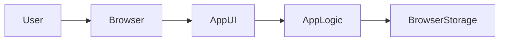

# Architecture Overview Cheatsheet

Use this when writing the architecture section in `project-hld.md`.

The lesson that uses this file is [lesson_plan.md](../Lesson/lesson_plan.md).

## What Architecture Means Here

Architecture is the shape of the app before code.

It answers these questions:

- Who uses the app?
- Where does the app run?
- What parts does the app have?
- What data does the app remember?
- Where does that data live?
- What happens when the user clicks, types, saves, edits, or deletes?

## Architecture Is Not A Feature List

A feature list says what the app can do.

```md
- Add a task
- Edit a task
- Delete a task
```

An architecture overview says how the app is shaped so those features can work.

```md
- The browser renders the task list screen.
- The app code stores tasks as JSON in local storage.
- The app reloads saved tasks when the page opens.
- The same task data is used by the add, edit, and delete flows.
```

## The Main Parts

| Part | What It Means | What To Write |
| --- | --- | --- |
| User | The person using the app. | Name the kind of user and their goal. |
| Browser | Where the app runs. | State that the app runs in the user's browser. |
| UI screens or states | What the user sees. | List the 3-4 main screens or states. |
| App logic | The rules and behavior. | Describe what happens when the user acts. |
| Browser storage | Data saved in the browser. | Name what data is stored and why. |
| External service | Anything outside the browser. | Include only if version 1 truly needs it. |

## Screens, State, And Data

These three ideas are connected.

| Idea | Meaning | Example |
| --- | --- | --- |
| Screen | A main view the user can see. | Task list screen |
| State | A mode or condition inside the app. | Editing an existing task |
| Data | Information the app remembers. | Task title, status, due date |

For a small browser app, you can often plan screens and states like this:

```md
| Screen or state | What the user does | Data used |
| --- | --- | --- |
| List | Views saved tasks | Reads all tasks |
| Add | Creates a task | Saves title and status |
| Edit | Changes a task | Updates one saved task |
| Empty state | Sees that no tasks exist | Reads zero saved tasks |
```

The empty state counts as a state, not always a separate screen.

## Browser Storage

Browser storage means the app saves data on the user's device through the browser.

Common beginner-friendly choices:

| Storage choice | Use when | Example |
| --- | --- | --- |
| In-memory state | Data can disappear on refresh. | A temporary calculator result |
| `localStorage` | Data should stay after refresh. | Saved tasks or notes |
| `sessionStorage` | Data should last only for the current tab session. | A short draft or temporary filter |

For this course, `localStorage` is usually the safest first choice when the app needs to remember data.

## Data Flow

Data flow means what happens to data as the user uses the app.

Example:

```md
1. The user types a task title.
2. The app validates that the title is not empty.
3. The app creates a task object.
4. The app saves the task list to local storage.
5. The app redraws the task list screen.
```

That is more useful than saying:

```md
The app handles tasks.
```

## Responsibility

Responsibility means what each part is responsible for.

Good architecture keeps responsibilities clear.

```md
| Part | Responsibility |
| --- | --- |
| UI | Shows screens and collects user input |
| App logic | Decides what happens when the user acts |
| Browser storage | Saves and loads project data |
```

Avoid mixing everything into one vague sentence:

```md
The app will manage the UI, logic, and data.
```

## Boundary

A boundary separates one part from another.

For this course, the most important boundary is:

```md
Browser app only. No backend. No production database.
```

That boundary protects the project from becoming too large.

If your project seems to require a backend, ask:

- Can version 1 use sample data?
- Can version 1 use local storage?
- Can accounts, sharing, or syncing move to version 2?
- Can the user export or copy data instead of saving it to a server?

## Good Architecture Overview

```md
## Architecture Overview

This is a browser-only app.

| Part | Responsibility |
| --- | --- |
| User | Creates, edits, completes, and deletes tasks |
| Browser | Runs the app and displays the screens |
| App UI | Shows list, add, edit, and empty states |
| App logic | Validates input and updates the task list |
| Browser storage | Saves tasks in local storage as JSON |

Data flow:

1. The app loads saved tasks from local storage.
2. The user creates or edits a task.
3. The app validates the task.
4. The app saves the updated task list to local storage.
5. The app redraws the current screen.

Version 1 does not use a backend or production database.
```

## Weak Architecture Overview

```md
The app has a frontend and backend. The user can add tasks and the database stores them.
```

This is weak because:

- it adds a backend without explaining why
- it adds a database without explaining what data needs it
- it does not say what screens exist
- it does not say what happens when the user acts
- it is too broad for a one-week implementation

## Optional Diagram

Diagrams are optional. Use one only if it makes the plan clearer.



If you use a diagram, still explain the parts in words or a table.

If you want to learn Mermaid, use the optional links in [enrichment.md](../Enrichment/enrichment.md).

## Quick Review

Your architecture overview is ready when:

- it says where the app runs
- it lists the main screens or states
- it names the data the app stores
- it says where the data is stored
- it explains the basic data flow
- it avoids a backend unless version 1 truly needs one
- it avoids a production database unless version 1 truly needs one
- it is clear enough for Codex to create implementation tasks
